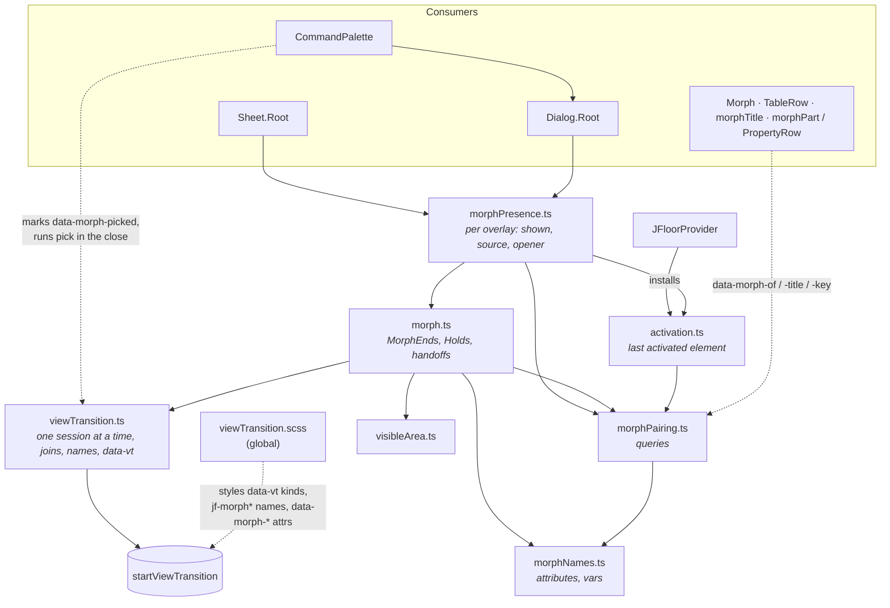

# The morph

A _morph_ is a View Transition in which one element on the page (a table row,
a kanban card, a button, the search field) grows into an overlay (a `Sheet`, a
`Dialog`, the `CommandPalette`), and the overlay shrinks back into it on close.
Text that both ends show (the title, a status cell and the sheet's status
field) flies on its own from one position to the other. Without the View
Transitions API, or under `prefers-reduced-motion`, the update just runs and the
overlay uses its own CSS pop-in.

This page describes how it works, for anyone changing it. The code lives in
`packages/design-system/src/utils/` (`viewTransition.ts`, `morph.ts`,
`morphPresence.ts`, `morphPairing.ts`, `morphNames.ts`, `activation.ts`,
`visibleArea.ts`) and `src/styles/viewTransition.scss`.

## Using it

Consumers write almost nothing:

```tsx
<Sheet.Root open={open()} onOpenChange={setOpen} morph={task._id}>
<Morph of={task._id}>…card…</Morph>          // something a sheet can close into
<h4 {...morphTitle}>{task.title}</h4>         // the text that flies as the title
<PropertyRow field={fields.status}>…           // a value paired by field key
<span {...morphPart(fields.dueDate)}>…</span>  // the same, outside a PropertyRow
```

Table rows need nothing: `TableRow` marks each row with its id and each cell's
content with its column id. The row's id is the table's row id (what the
table's `getRowId` returns), so it must be the same id the sheet is given as
`morph`.

The playground's **Morph** demo shows every case: three cards and a small
table open into one sheet, a table row opens from the keyboard (focus the
table, arrow to a row, Enter), and "Move card" reorders the cards while the
sheet is open, so it closes into the card at its new place.

## The modules and what each one owns

| Module                              | Role                                                                                                                                                                                                                                                                    | State it owns                                                                                                                                                                                                                                                                                                                                                    |
| ----------------------------------- | ----------------------------------------------------------------------------------------------------------------------------------------------------------------------------------------------------------------------------------------------------------------------- | ---------------------------------------------------------------------------------------------------------------------------------------------------------------------------------------------------------------------------------------------------------------------------------------------------------------------------------------------------------------- |
| `utils/viewTransition.ts`           | The only caller of `document.startViewTransition`. Runs one transition at a time; a call made while an update runs **joins** it. Hands each update a `TransitionScope` (`name`, `unname`, `kind`, `beforeSnapshot`).                                                    | Module: `updating`, `latest` session, `owner` (element → session that named it). Per session: queued updates, snapshot callbacks, kinds, names. DOM: `data-vt` on `<html>`, inline `view-transition-name` / `-class`.                                                                                                                                            |
| `utils/morph.ts`                    | One morph: decides what each snapshot holds (which element carries which name), draws the surface between the ends, pins and strips the trigger's look, offers and honours the overlay handoff (`claimHandoff`, `joinHandoff`).                                         | Module: `handoffs` (scope → handoff), three `Holds` (`pins`, `strips`, `roots`) recording which morph owns each piece of page state. Per morph: a `MorphEnds`. DOM: the ghost `<div>`, `data-morph-pinned` + pin vars, `data-morph-stripped`, momentary `data-morph-settling`, `--jf-morph-from-*` / `--jf-morph-to-*` and `--jf-morph-source-clip` on `<html>`. |
| `utils/morphPresence.ts`            | An overlay's lifecycle: turns the consumer's `open` into a morph, picks the source, hides it while open, picks the close target, restores focus.                                                                                                                        | Per overlay: `shown` signal (what Ark sees), source, opener, request/closing/disposed flags. DOM: `data-morph-hidden` on the source; reads and clears `data-morph-picked`.                                                                                                                                                                                       |
| `utils/morphNames.ts`               | Every attribute and custom property the morph puts on the page, spelled once. The stylesheets use the same spelling, and a contract test keeps them in step.                                                                                                            | None.                                                                                                                                                                                                                                                                                                                                                            |
| `utils/morphPairing.ts`             | Which entity an element shows, and which text inside an end takes part. Pure DOM queries.                                                                                                                                                                               | None. Defines `data-sheet-skeleton`.                                                                                                                                                                                                                                                                                                                             |
| `utils/activation.ts`               | Remembers the element a person last activated (pointerdown, Enter, Space), for 1 s. On a key press, a widget that names its current item with `aria-activedescendant` (a grid's focused row) resolves to that item.                                                     | Module: `last = { element, at }`.                                                                                                                                                                                                                                                                                                                                |
| `utils/visibleArea.ts`              | Geometry: the on-screen part of an element, whether it is fully visible, the clip inset that cuts a snapshot to it.                                                                                                                                                     | None.                                                                                                                                                                                                                                                                                                                                                            |
| `styles/viewTransition.scss`        | Every `::view-transition-*` rule of the design system, plus the page-level rules for the morph's attributes (hidden, pinned, stripped, settling, ghost).                                                                                                                | None.                                                                                                                                                                                                                                                                                                                                                            |
| `JFloorProvider.tsx`                | Installs the activation listeners once (`trackActivation`).                                                                                                                                                                                                             | —                                                                                                                                                                                                                                                                                                                                                                |
| `Sheet`, `Dialog`, `CommandPalette` | Call `createMorphPresence`; pass `shown()` to Ark as `open`; turn Ark's own focus restore off. `Sheet` marks its backdrop `data-morph-scrim` and its title `data-morph-title`. The palette marks the picked row `data-morph-picked` and runs the pick inside its close. | Their content element ref.                                                                                                                                                                                                                                                                                                                                       |
| `Morph`, `TableRow`, `fields.ts`    | Markers only: `data-morph-of` (`Morph`, each row), `data-morph-title` / `data-morph-key` (row cells, `morphTitle`, `morphPart`, `PropertyRow`).                                                                                                                         | None.                                                                                                                                                                                                                                                                                                                                                            |



## Vocabulary

**Transition names** (one element each per transition; a duplicate makes the
browser skip the whole transition, so `scope.name` refuses a second holder):

| Name                                          | Carried by                                                                                                                                                 | Snapshot          |
| --------------------------------------------- | ---------------------------------------------------------------------------------------------------------------------------------------------------------- | ----------------- |
| `jf-morph`                                    | Open: the ghost (old), the overlay content (new). Close: the content (old), a ghost over the target (new). Scale look: the field and the content directly. | both              |
| `jf-morph-source`                             | The trigger's own content, its surface stripped, fading where it is. Open: old only. Close: new only.                                                      | one               |
| `jf-morph-scrim`                              | The overlay's backdrop. Open: new only. Close: old only.                                                                                                   | one               |
| `jf-morph-title`                              | The marked title of each end.                                                                                                                              | both, or old only |
| `jf-morph-part-<key>` (class `jf-morph-part`) | Each keyed value, paired across ends by exact key.                                                                                                         | both, or old only |

**Kinds** (space-separated in `<html data-vt>`): `morph` always; `morph-box` or
`morph-scale` (opposites, the latest wins); `morph-grow` (open with a surface)
or `morph-shrink` (close with a surface).

**Page attributes** (all in `morphNames.ts`): `data-morph-ghost`,
`data-morph-pinned`, `data-morph-stripped`, `data-morph-settling`,
`data-morph-scrim`, `data-morph-hidden`, `data-morph-picked`, plus the markers
`data-morph-of`, `data-morph-title`, `data-morph-key`. `data-sheet-skeleton`
(in `morphPairing.ts`) marks placeholder content that never takes part.

**Custom properties** (all in `morphNames.ts`): the pin colours
`--jf-morph-pin-bg` / `--jf-morph-pin-border`; the two ends' surfaces
`--jf-morph-from-*` / `--jf-morph-to-*` (`background`, `border-color`,
`border-width`, `radius`); the ghost's `--jf-ghost-*` (box and surface); the
source clip `--jf-morph-source-clip`. The stylesheet's own
`--jf-morph-ring-from` / `-to` are derived from them in the stylesheet.

## Looks

The look is decided by the **trigger's end**: the source on open, the element
closed into on close (`lookOf`). An end "has a container" (`hasContainer`)
when it is a row or a `data-morph-of` element, or it paints a background,
border or shadow at rest (read off an unhovered copy), or it is a field whose
input wrapper paints.

- **Scale look** (`morph-scale`): a text field with a container, i.e. the
  search field into the palette. The browser's own geometry: both snapshots
  scale with the box while they crossfade. No ghost, no surface, no pin, no
  value flights.
- **Box look** (`morph-box`), everything else. With an end to draw from it is
  a **surface morph**: the box the browser animates is painted live on
  `::view-transition-image-pair(jf-morph)`, its fill, inset-shadow border and
  corner moving from `--jf-morph-from-*` to `--jf-morph-to-*`; the content
  keeps its natural size, pinned top-left and clipped by the growing box.
  - A trigger **with** a container becomes the card: a ghost of its surface
    grows into the overlay, while its own text fades where it is.
  - A trigger **without** one (an icon button) stays live and visible; the
    card grows out of its box.
- A `null` end (nothing to open from or close into) scales from or to the
  page centre (`:only-child` rules).

## The open sequence

1. **Activation is recorded.** A capture listener (`activation.ts`) stores the
   closest `button`, `a`, row, option or `[data-morph-of]` around a
   pointerdown, Enter or Space. On a key press it first follows
   `aria-activedescendant`, so Enter on a focused grid records the ring row.
2. **The consumer sets `open`.** `createMorphPresence`'s effect calls `show`.
   It records the opener (the focused element outside the overlay). If a
   closing overlay is offering a handoff, this overlay claims it and joins
   (see _Handoff_). Otherwise the **source** is the recent activation, else
   the first on-screen `morphFrom` candidate (`openFrom`). Whether the source
   will be hidden is measured now (`takesPlaceOf`: animating and the source
   has a container).
3. **`morph` prepares the old snapshot** (the `MorphEnds` constructor), in
   this order, because each step reads the live style the next one changes:
   1. `reclaim(source)`: if an earlier morph still strips it (the row is
      clicked again while its sheet closes into it), give its surface back.
   2. Pick the look. A surface morph needs the box look, the API, no running
      transition to join, and a source.
   3. **Pin** the source and each child painting its own fill: their current
      background and border colours are copied into inline vars and
      `data-morph-pinned` applies them with `!important`. Chrome drops
      `:hover` when a transition starts; the pin keeps the hovered look in
      the live frame and the old snapshot.
   4. With a container: read its surface, set the source clip (a row
      scrolled sideways is captured whole; the clip cuts it to what is on
      screen).
   5. Place the **ghost**: a fixed, content-free `<div>` over the visible
      part of the source, painting its surface.
   6. With a container: **strip** the source and its filled children
      (`data-morph-stripped`: no background, border, shadow or outline). The
      ghost, exactly over it, covers that frame; the source's snapshot now
      holds only its text and icons.
4. **Old-side names** (`morph()`, via `moveName`): `jf-morph` on the ghost
   (or the source itself when there is no ghost); `jf-morph-source` on a
   container source; `jf-morph-title` on the source's visible title; a
   `jf-morph-part-<key>` on each fully visible keyed value (only when the
   source has a container). Kind `morph` is written; `startViewTransition`
   runs and the browser captures the **old snapshot**.
5. **Update** (inside the transition): old names are removed; the ghost is
   removed; `morph-box` or `morph-scale` is written; `setShown(true)` lets Ark
   render the overlay; a container source gets `data-morph-hidden` (the
   overlay _is_ that element now). Other calls made meanwhile join; the
   session waits at most `SETTLE_CAP_MS` (50 ms) for them.
6. **Before the new snapshot** (`beforeSnapshot`): the target (the overlay
   content, which the update just rendered) is resolved, once; for a surface
   morph the from/to surface vars go on `<html>` and kind `morph-grow` is
   added. New names: `jf-morph` on the content, `jf-morph-scrim` on its marked
   backdrop, `jf-morph-title` on the target's value with the title's key,
   else its title; each part on the target's value with the same key.
   Placeholder content (`data-sheet-skeleton`), values inside closed sections
   and values of a nested entity never take part. The browser captures the
   **new snapshot** and animates.
7. **Cleanup** (`transition.finished`, also on skip or failure): the session
   clears the names it still owns and `data-vt`; the morph removes the ghost
   and lets go of the pins, strips and root vars **it still holds** (a newer
   morph may have taken them). A stripped element gets its surface back under
   `data-morph-settling`, which turns its own CSS transition off for that one
   style change, so a filled button does not fade back in after the ghost
   has gone.

## The close sequence

1. **The consumer clears `open`.** `hide` takes the remembered source and
   marks the overlay as closing.
2. **The close's source** is the element inside the overlay marked
   `data-morph-picked` (the palette's picked row), else a row activated
   inside it, else the overlay content (`closeFrom`).
3. **The close's target** is the original source if it is still rendered,
   else the on-screen element showing the overlay's `morph` id
   (`findMorphTarget`: `[data-morph-of="<id>"]`), else none (`closeTo`). A
   sheet that stepped to another record (prev/next) has already forgotten its
   source, so it closes into that record's row. The target is read **once,
   as the close is asked for**: it is on screen already, and which values fly
   is decided against it before the transition starts.
4. **Old-side names**: `jf-morph` on the close source, `jf-morph-scrim` on
   the closing overlay's backdrop, its title, and each keyed value that has a
   visible counterpart in the target (one with nowhere to land is left
   unnamed, so it shrinks with the card). The surface it starts from is read
   now. As soon as the close is asked for, it **offers a handoff**.
5. **Update**: the source is un-hidden, `setShown(false)`.
6. **Before the new snapshot** the target read in step 3 takes over, unless
   an overlay claimed the handoff (then the claimant's content does). Any
   strip an earlier open still holds on it is reclaimed; its look is written.
   For a surface close into a container: surface vars, a ghost over the
   target painting its surface, the target named `jf-morph-source` (its
   content fades back in) and stripped; kind `morph-shrink`. Into an icon,
   the card shrinks to the icon's box while it fades to transparent. The
   ghost carries `jf-morph`.
7. **Cleanup** as on open; then the presence clears `data-morph-picked` and
   restores focus to the opener, unless the close was handed off, the overlay
   was reopened meanwhile, or focus has moved elsewhere on its own.

```mermaid
sequenceDiagram
  autonumber
  actor User
  participant Act as activation.ts
  participant Pres as morphPresence
  participant M as morph (MorphEnds)
  participant VT as viewTransition
  participant B as Browser
  participant CSS as viewTransition.scss

  rect rgba(127,127,127,0.08)
  note over User,CSS: Open
  User->>Act: pointerdown / Enter on a row
  User->>Pres: open = true (consumer state)
  Pres->>Act: recentActivation()
  Pres->>M: morph({ from: row, to: content, update })
  M->>M: reclaim · pick look · pin · read surface · clip · ghost · strip
  M->>VT: moveName(jf-morph→ghost, jf-morph-source→row, title, parts)
  VT->>B: startViewTransition (data-vt="morph")
  B-->>B: old snapshot
  B->>VT: update callback
  VT->>M: unname old side, remove ghost, kind morph-box
  M->>Pres: update(): setShown(true), hide row
  VT->>M: beforeSnapshot: resolve target
  M->>VT: surface vars, kind morph-grow, jf-morph→content, scrim, title, parts
  B-->>B: new snapshot, animate
  CSS-->>B: surface keyframes, fades, layers
  B->>VT: finished
  VT->>M: clear names & data-vt; ghost, unpin, unstrip, clear vars
  end

  rect rgba(127,127,127,0.08)
  note over User,CSS: Close
  User->>Pres: open = false
  Pres->>M: morph({ from: content, direction: close, to: row | Morph of id })
  M->>M: read the target once
  M->>VT: moveName(jf-morph→content, scrim, title, landing parts)
  M->>M: offer handoff on the running session
  VT->>B: startViewTransition
  B-->>B: old snapshot
  B->>Pres: update(): unhide row, setShown(false)
  VT->>M: beforeSnapshot: the target (or the claimant)
  M->>VT: reclaim, kind morph-shrink, ghost over row = jf-morph, row = jf-morph-source (stripped)
  B-->>B: new snapshot, animate
  B->>VT: finished
  VT->>M: cleanup
  M->>Pres: { handedOff }
  Pres->>Pres: clear data-morph-picked, restore focus unless handed off
  end
```

## What the CSS animates (`styles/viewTransition.scss`)

- `:root[data-vt] { view-transition-name: none }`: only named elements
  animate; the rest of the page does not crossfade.
- `::view-transition { pointer-events: none }`, except the `jf-morph` group,
  which takes the pointer so a second click on a closing sheet's X does not
  fall through to the row beneath.
- **Stacking**, bottom to top: scrim (`$layer-scrim`), the trigger's content
  (`$layer-source`), the surface (`$layer-surface`), flying text
  (`$layer-text`).
- **Box look**: `jf-morph` snapshots keep their natural size, top-left,
  clipped by the box. Surface kinds paint the image pair from the from-vars
  to the to-vars (`jf-vt-morph-surface-grow` / `-shrink`); the fill changes
  near the trigger's end (`$fill-switch`), corner and border over the whole
  morph. On grow the ghost's snapshot hides and the content fades in over the
  last third; on shrink the content fades out fast and the ghost's snapshot
  hides.
- **Scale look**: the browser's default geometry, with the morph's duration
  and curve.
- `jf-morph-source`: clipped to `--jf-morph-source-clip`; fades out fast
  (`--jf-animation-duration-fast`) as an open starts, and fades in over the
  last stretch of a close (the same short fade, delayed to end with the
  morph).
- Title and parts: moved and scaled by the browser, scaled by line height and
  left-aligned so short text into long text does not stretch; one with no
  counterpart fades out where it is.
- Page rules: `[data-morph-hidden]` is `visibility: hidden`;
  `[data-morph-pinned]` applies the pin vars; `[data-morph-stripped]` drops
  the surface (`background: none`, transparent border, no shadow or
  outline); stripped and settling elements run no CSS transition; the ghost
  is a fixed box drawn from its inline vars.
- Component modules cooperate through `:root[data-vt~="morph"]`: `Sheet` and
  `Dialog` turn off their own pop-in and scrim fade while a morph does the
  animating; the `Table` focus ring stays off a pinned row (its text weight
  would otherwise jump as it flies).

## Handoff between overlays

A palette pick that opens a sheet is one transition, and the picked row grows
into the sheet:

1. `CommandPalette` marks the picked row `data-morph-picked`, asks to close,
   and runs the item's `onSelect` in `viewTransition`, which **joins** the
   close (the close's session is already updating).
2. The close **offers** a handoff on its session as soon as it is asked for.
3. `onSelect` opens the sheet; its presence finds the offer and **claims** it
   (`claimHandoff`), passing its content as the target, then opens through
   `joinHandoff`, which joins the transition and only flips `shown`.
4. Before the new snapshot the closer names the claimant's content
   `jf-morph` instead of its own target. The claimant's look joins later and
   wins, so the target decides the look (a box morph).
5. The closer resolves `{ handedOff: true }` and does not restore focus.

An overlay reopening during its own close never claims its own handoff. A
handoff only happens when the second overlay opens inside the first one's
update (within the 50 ms cap); a slower open scales in from the page centre.

## Overlapping morphs

A row clicked again while its sheet is still closing into it starts a morph
on an element the previous one still pins and strips. Each piece of shared
state (an element's pin, an element's strip, the root surface vars, the root
clip) is held by exactly one morph at a time (`Holds` in `morph.ts`); a new
morph `reclaim`s and takes it, and the earlier morph's cleanup lets go only
of what it still holds. Transition names follow the same rule in
`viewTransition.ts` (`owner`).

## Limits

These only ever cost an animation; the page always ends in the right state.

- A list that re-renders its rows during a close (fresh row objects) unmounts
  the named target mid-transition; the browser skips the close and the sheet
  simply disappears.
- Never put a morph marker on an element that is swapped while the overlay is
  open (inside a `Show` or `Deferred` that changes): a named element that
  stops rendering makes the browser skip the transition. Skeletons never take
  part for this reason. A sheet builds its body inside its first open, so
  that open flies only the surface and title; values pair on later opens and
  every close.
- A handoff needs the second overlay to open within the 50 ms update cap.
- Only fully visible values fly; a cell scrolled out of its table stays with
  the card.
- Several on-screen elements with the same `data-morph-of`: the close goes to
  the first, with a development warning.
- On iOS a swipe-back plays Safari's own animation.

## How it is tested

- `utils/viewTransition.test.ts`: sessions, joins, ownership, cleanup on
  finish, skip and failure.
- `utils/morph.test.ts`: the snapshot contract. Fakes
  (`test/viewTransitionFakes.ts`) call back where the browser would take the
  old and new snapshots, and the tests assert which element holds which name,
  `data-vt`, the root vars and the page attributes at each point, then that
  everything is gone after. Also: overlap and reclaim, cleanup errors, a
  close reading its target once, a partly off-screen source (mocked layout:
  clipped source, ghost over the visible part, only whole values fly), and
  the stylesheet's layer order and rules.
- `styles/viewTransition.contract.test.ts`: every `data-morph-*` attribute
  and morph custom property the stylesheets (`viewTransition.scss`,
  `Table.module.scss`) use is spelled the same in `morphNames.ts`.
- `utils/morphPresence.test.tsx`, `Sheet.test.tsx`, `Dialog.test.tsx`,
  `activation.test.ts`, `morphPairing.test.ts`, `visibleArea.test.ts`:
  source choice, hiding, focus, handoff, close targets, pairing, geometry.
- The motion itself only exists in a real browser: every change to this area
  is checked in the running app (open and close from a row, a card, a button,
  the palette at desktop and phone width, a handoff, prev/next, reduced
  motion), and with the probe below.

## Running the probe

`packages/design-system/scripts/morph-probe.js` is a
[chrome-devtools-axi](https://www.npmjs.com/package/chrome-devtools-axi)
`run` script. It opens the playground's Morph demo, opens the first card into
its sheet and closes it, twice (the first open builds the sheet's body, so
only the second pairs the values), and prints for each transition its kinds,
the time from `ready` to `finished`, and every animation frame's
view-transition pseudo-elements (size, transform, opacity). A `ready` to
`finished` gap of 0 means the browser skipped the transition, and one under
half the morph's duration (`--jf-animation-duration-morph`, read from the
page) is flagged as likely skipped. It is not run in CI; run it for every
change to the motion.

From the repository root, in one shell:

```sh
bun run --cwd packages/design-system demo &   # the playground, in the background
npx -y chrome-devtools-axi run < packages/design-system/scripts/morph-probe.js
kill %1                                        # stop the playground
```

Set `MORPH_PROBE_URL` (for example `http://localhost:5174/`) when Vite picked
another port than 5173: it prints the one it took.
