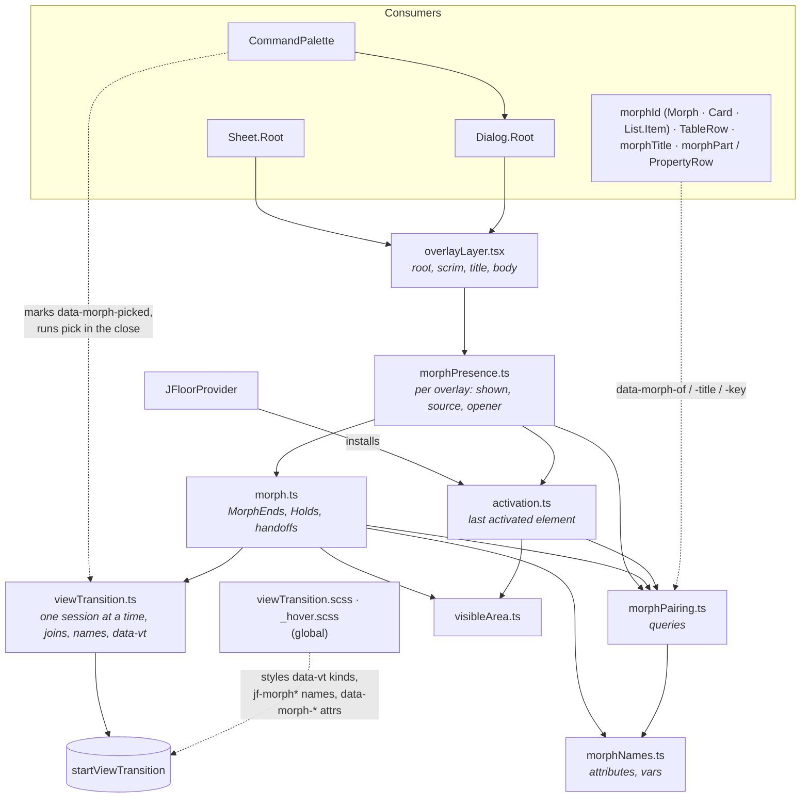

# The morph

A _morph_ is a View Transition in which one element on the page (a table row,
a kanban card, a button, the search field) grows into an overlay (a `Sheet`, a
`Dialog`, the `CommandPalette`), and the overlay shrinks back into it on close.
Text that both ends show (the title, a status cell and the sheet's status
field) flies on its own from one position to the other. Without the View
Transitions API, or under `prefers-reduced-motion`, the update just runs. Under
reduced motion every duration token is zero, so the overlay's own CSS pop-in
ends at once too.

This page describes how it works, for anyone changing it. The code lives in
`packages/design-system/src/utils/` (`viewTransition.ts`, `morph.ts`,
`morphPresence.ts`, `overlayLayer.tsx`, `morphPairing.ts`, `morphNames.ts`,
`activation.ts`, `visibleArea.ts`), `src/styles/viewTransition.scss` and the
hover mixin in `src/styles/_hover.scss`.

## The contract

A component or page is _morph-native_ when it follows these rules. Each one
closes a way a morph used to break.

1. **Modal overlays morph; anchored popups never do.** Sheet, Dialog and
   anything built on them use the overlay layer (`utils/overlayLayer.tsx`).
   It opens them through `createMorphPresence`, marks the backdrop as the
   morph's scrim and the title as its title. Each overlay's stylesheet turns
   its own pop-in off under `:root[data-vt~="morph"]`. Anything placed
   against a trigger (`data-placement`: Popover, Menu, Select, Combobox,
   DatePicker, TimePicker, Tooltip, Tour) keeps its CSS pop.
2. **One prop makes an entity surface.** A card, list item or `Morph`
   wrapper that shows a record takes `morphId`. A table row takes its id
   from `getRowId`. The overlay gets the same id as `morphId`. `Card.Title` and
   `List.ItemTitle` mark the title inside an element with a `morphId`. Each
   value is keyed by its `FieldDefinition` (`fieldColumn`,
   `PropertyRow field`, `morphPart`). Apps never write `data-morph-*`.
3. **Anything that can open an overlay is a source.** A button, link, row,
   option, menu item, or a control whose shortcut key was pressed.
4. **The trigger looks the same through the morph.** Every hover look is
   written with the hover mixin, which also matches the morph's pin. A press
   look (`:active`) is not pinned: a press ends as the morph starts.
5. **Nothing marked is swapped mid-transition.** Markers stay off skeletons
   and off anything inside a changing `Show` or `Deferred`. Tables keep their
   row elements and each cell's content across refreshes, virtualized bodies
   too. Overlay content is never gated on `open`.
6. **No motion means no motion.** Without the API or under reduced motion,
   the state changes at once, and every duration token is zero.

Contract tests check the parts of this a machine can read off the source
(see _How it is tested_).

## Using it

Consumers write almost nothing:

```tsx
<Sheet.Root open={open()} onOpenChange={setOpen} morphId={task._id}>
<Card.Root morphId={task._id} onHoverIntent={prebuild}>…</Card.Root>  // something a sheet can close into
<Morph morphId={task._id}>…card…</Morph>        // the same, around any element
<h4 {...morphTitle}>{task.title}</h4>           // the text that flies as the title
<PropertyRow field={fields.status}>…             // a value paired by field key
<span {...morphPart(fields.dueDate)}>…</span>    // the same, outside a PropertyRow
```

Table rows need nothing. `TableRow` marks each row with its id and each
cell's content with its column id. The row's id is the table's row id (what
the table's `getRowId` returns), so it must be the same id the sheet is given
as `morphId`. A `fieldColumn`'s id is its field's key, so a column and a
`PropertyRow` for the same field pair up.

`Card.Root`, `List.Item` and `Morph` share one prop type, `Morphable`
(`morphId?`), and one helper, `morphAttributes(props)`, both in
`components/Morph/Morph.tsx`. Neither is exported from the package. The
apps/web lint bans `data-morph-*` JSX attributes.

**Hover looks.** Chrome drops `:hover` as a View Transition starts. A
component styled on `:hover` would lose that look in the morph's live frame
and in the old snapshot. So write every hover look with the `hover` mixin:

```scss
@use "../../styles/hover"; // an app: @use "@j-os/design-system/hover";

.row {
  @media (hover: hover) {
    @include hover.hover {
      background-color: var(--jf-surface-bg-overlay);
    }
  }
}
```

The mixin emits `&:hover` and the pinned selector (`MORPH_PINNED_SELECTOR`,
`[data-morph-pinned="held"]`) together. Fills, text colour, borders,
pseudo-element bubbles (`&::before` inside the include) and descendant rules
(`tr { @include hover.hover { & td { … } } }`) all hold. Keep any
`@media (hover: hover)` guard around the include. Raw `:hover` is a lint
error in every stylesheet, in every package (`selector-pseudo-class-disallowed-list`
in the shared stylelint config); `_hover.scss` is the only place it is
written.

**Overlays.** Sheet, Dialog and what is built on them (the CommandPalette is
a Dialog) use the overlay layer. `OverlayRoot` opens Ark's dialog through
`createMorphPresence`. The presence is created inside Ark's root, so an
`open` set on the first render, or in the caller's mount effect, opens.
`OverlayBackdrop` is the scrim (`MORPH_SCRIM`). `OverlayTitle` is the title
(`MORPH_TITLE`), except while `loading`: nothing flies into a shimmer bar.
The marked scrim fades with the morph whatever the look (box or scale), and
with or without a source (an overlay opened with nothing to grow from, or
closed into nothing), except in a morph that joins a transition already
running. On a handoff it stays one scrim: the closer's in the old snapshot,
the claimant's in the new.

**Stacked overlays.** The layer keeps one stack of the shown overlays, in
the order they were shown. Each content carries how many are shown above
it (`--jf-overlays-above`, and `data-overlay-covered` while that is more
than none), written as `shown` changes, so inside the morph's update. A
sheet steps back by it (`Sheet.module.scss`). Ark keeps a count of its own
(`--nested-layer-count`), but writes it a frame after an overlay opens, and
inside a morph that frame comes after the new snapshot. While shown, a
content is marked `data-morph-layer`; a morph names each marked overlay
under the one it opens or closes (`jf-morph-stacked-<n>`) in both
snapshots. The stylesheet turns the sheet's own transitions off under a
morph, so the lower sheet reaches its new place in the update and the
browser moves it there as its own group, on the morph's duration. A card
closing into a button on it is measured where the button will rest, so
the morph ends without a jump.

**Overlay content.** Never gate overlay content on the caller's `open`. It
turns false before the browser captures the closing card, so the card would
shrink empty. A dialog's content (everything inside `Dialog.Content`) is
built on each opening, including one made while the close still runs. It is
kept through the close morph and, without a morph, until the card's own CSS
exit has finished. Then it is dropped, so a closed dialog leaves no inputs
in the page and every opening starts afresh. `Dialog.Header` (title,
description, close button), `Dialog.Body` and `Dialog.Footer` lay the card
out, named as `Sheet`'s parts are.

Sheet parts are built on the first show and kept. `Sheet.Root prebuild`
builds them before the first open, so that open flies values like every
later one. The app sets it from a row's hover intent through
`createEntitySelection`'s `intend()` and `prebuild()`. Prebuilt or held
content is hidden by `visibility: hidden` (plus Ark's `hidden`), so its
shortcut buttons match no key press. A card that opens a sheet passes
`onHoverIntent` to `Card.Root` (a table row, `onRowHoverIntent`), never a
hand-wired `createHoverIntent`. The same holds for any content that is
mounted but not shown: it must really be hidden (`display: none`,
`visibility: hidden` or `hidden`), or its shortcut buttons match.

**Holding what the morph shows.** `createMorphHold(value, live, settled?)`
returns `value` while `live`. After `live` turns false it keeps the last
live value until the morph that change started has finished, then until
`settled()` resolves if given, then returns `undefined`. The wait starts a
microtask later, because the morph starts in the effects the change sets
off. A later let-go is not ended by an earlier one's morph. It holds a
sheet's row after its selection clears (`createEntitySelection`'s
`shownId`), a drag preview a sheet grows out of, and a dialog's content
(with the content's own exit as `settled`).

The playground's **Morph** demo shows each case:

- three cards and a small table open into one sheet; resting the pointer on
  one first builds the sheet (`prebuild`), so even the first open flies its
  values;
- a table row opens from the keyboard (focus the table, arrow to a row,
  Enter);
- a row's score field grows its box into the sheet's field, and its status
  pill flies as one box;
- a row action (an icon button in the row) opens a dialog out of itself;
- the "New item" icon button opens a dialog, by click or by its key (N);
- "Search" opens the palette, and a pick grows into the item's sheet in the
  same transition (the handoff);
- "Move card" reorders the cards while the sheet is open, so it closes into
  the card at its new place.

## The modules and what each one owns

| Module                                           | Role                                                                                                                                                                                                                                                     | State it owns                                                                                                                                                                                                                                                                                      |
| ------------------------------------------------ | -------------------------------------------------------------------------------------------------------------------------------------------------------------------------------------------------------------------------------------------------------- | -------------------------------------------------------------------------------------------------------------------------------------------------------------------------------------------------------------------------------------------------------------------------------------------------- |
| `utils/viewTransition.ts`                        | The only caller of `document.startViewTransition`. Runs one transition at a time; a call made while an update runs **joins** it. Hands each update a `TransitionScope` (`name`, `unname`, `kind`, `beforeSnapshot`).                                     | Module: `updating`, `latest` session, `owner` (element → session that named it). Per session: queued updates, snapshot callbacks, kinds, names. DOM: `data-vt` on `<html>`, inline `view-transition-name` / `-class`.                                                                              |
| `utils/morph.ts`                                 | One morph: decides what each snapshot holds (which element carries which name), draws the surface between the ends on their painted boxes, pins what the pointer holds, offers and honours the overlay handoff (`claimHandoff`, `joinHandoff`).          | Module: `handoffs` (scope → handoff), two `Holds` (`pins`, `roots`) recording which morph owns each piece of page state. Per morph: a `MorphEnds`. DOM: the ghost `<div>`, `data-morph-pinned`, `--jf-morph-from-*` / `--jf-morph-to-*`, box-flight vars and `--jf-morph-source-clip` on `<html>`. |
| `utils/morphPresence.ts`                         | An overlay's lifecycle: turns the consumer's `open` into a morph, picks the source, hides it while open, picks the close target, restores focus. Also `createMorphHold`.                                                                                 | Per overlay: `shown` signal (what Ark sees), source, opener, request/closing/disposed flags. DOM: `data-morph-hidden` on the source; reads and clears `data-morph-picked`.                                                                                                                         |
| `utils/overlayLayer.tsx`                         | The layer every modal overlay is made of: `OverlayRoot` (Ark's dialog root opened through the presence), `OverlayBackdrop` (the scrim), `OverlayContent` (the target), `OverlayTitle` (the title), `OverlayParts` and `OverlayBody` (content lifetimes). | Module: the stack of shown overlays. Per overlay: the show count, whether the parts are built, the content element. DOM: `data-morph-layer`, `data-overlay-covered`, `--jf-overlays-above` on the content.                                                                                         |
| `utils/morphNames.ts`                            | Every attribute and custom property the morph puts on the page, spelled once. The stylesheets use the same spelling, and contract tests keep them in step.                                                                                               | None.                                                                                                                                                                                                                                                                                              |
| `utils/morphPairing.ts`                          | Which entity an element shows, and which text inside an end takes part. Pure DOM queries.                                                                                                                                                                | None. Defines `data-sheet-skeleton`.                                                                                                                                                                                                                                                               |
| `utils/activation.ts`                            | Remembers the element a person last activated (pointerdown, Enter, Space, or a shortcut key), for `ACTIVATION_TTL_MS` (1 s).                                                                                                                             | Module: `last = { element, at }`.                                                                                                                                                                                                                                                                  |
| `utils/visibleArea.ts`                           | Geometry: the on-screen part of an element, whether it is fully visible, the clip inset that cuts a snapshot to it, and the nearest visible anchor of an element (`nearestVisibleAnchor`).                                                               | None.                                                                                                                                                                                                                                                                                              |
| `styles/viewTransition.scss`                     | Every `::view-transition-*` rule of the design system, plus the page-level rules for the morph's attributes (hidden, ghost).                                                                                                                             | None.                                                                                                                                                                                                                                                                                              |
| `styles/_hover.scss`                             | The `hover` mixin: `:hover` and the pinned selector in one rule. The one place `:hover` is written.                                                                                                                                                      | None.                                                                                                                                                                                                                                                                                              |
| `JFloorProvider.tsx`                             | Installs the activation listeners once (`trackActivation`).                                                                                                                                                                                              | —                                                                                                                                                                                                                                                                                                  |
| `Sheet`, `Dialog`, `CommandPalette`              | `Sheet` and `Dialog` are built on the overlay layer. The palette is a `Dialog`; it marks the picked row `data-morph-picked` and runs the pick inside its close.                                                                                          | Their own parts.                                                                                                                                                                                                                                                                                   |
| `Morph`, `Card`, `List`, `TableRow`, `fields.ts` | Markers only: `data-morph-of` (`morphId` on `Morph`, `Card.Root`, `List.Item`; each row), `data-morph-title` / `data-morph-key` (row cells, `Card.Title`, `List.ItemTitle`, `morphTitle`, `morphPart`, `PropertyRow`).                                   | None.                                                                                                                                                                                                                                                                                              |



## Vocabulary

**Transition names** (one element each per transition; a duplicate makes the
browser skip the whole transition, so `scope.name` refuses a second holder):

| Name                                                           | Carried by                                                                                                                                                                                                                   | Snapshot          |
| -------------------------------------------------------------- | ---------------------------------------------------------------------------------------------------------------------------------------------------------------------------------------------------------------------------- | ----------------- |
| `jf-morph`                                                     | Open: the ghost (old), the overlay content (new). Close: the content (old), a ghost over the target (new). Handoff: the closer's source (old), the claimant's content (new). Scale look: the field and the content directly. | both              |
| `jf-morph-source`                                              | The trigger's painted box, fill and all, fading where it is. Open: old only. Close: new only.                                                                                                                                | one               |
| `jf-morph-scrim`                                               | The overlay's backdrop. Open: new only. Close: old only. Handoff: the closer's (old), the claimant's (new).                                                                                                                  | one, or both      |
| `jf-morph-title`                                               | The marked title of each end.                                                                                                                                                                                                | both, or old only |
| `jf-morph-part-<key>` (class `jf-morph-part`)                  | Each keyed value, paired across ends by exact key: the box it paints, if any, else the value itself. A box flight adds `jf-morph-box jf-morph-box-<slot>` on the new end.                                                    | both, or old only |
| `jf-morph-stacked-<n>` (class `jf-morph-stacked`)              | Each overlay shown under the one opening or closing (`data-morph-layer`), so it steps back or forward as its own group. None in a morph that joins a running transition.                                                     | both              |
| `jf-table-row-<id>` (class `jf-table-row`)                     | A table row on screen while a group collapses or expands (see _Table groups_).                                                                                                                                               | both, or one      |
| `jf-table-group-<key>` (classes `jf-table-row jf-table-group`) | A group header on screen while a group collapses or expands.                                                                                                                                                                 | both              |

**Kinds** (space-separated in `<html data-vt>`): `morph` always; `morph-box` or
`morph-scale` (opposites, the latest wins); `morph-grow` (open with a surface),
`morph-shrink` (close with a surface) or `morph-handoff` (a close handed to
an overlay opening in the same transition, with a surface). A table group's
toggle is `table-collapse` or `table-expand` (opposites).

**Page attributes** (all in `morphNames.ts`): `data-morph-ghost`,
`data-morph-pinned` (value `held`; `MORPH_PINNED_SELECTOR` is
`[data-morph-pinned="held"]`), `data-morph-scrim`, `data-morph-hidden`,
`data-morph-picked`, `data-list-row` (on every `List.Item`),
`data-morph-layer` (a shown overlay's content, set by the overlay layer),
plus the markers `data-morph-of`, `data-morph-title`, `data-morph-key`.
`data-sheet-skeleton` (in `morphPairing.ts`) marks placeholder content that
never takes part. The overlay layer's own `data-overlay-covered` and
`--jf-overlays-above` (in `overlayLayer.tsx`) say what is shown above a
content.

**Custom properties** (all in `morphNames.ts`): the two ends' surfaces
`--jf-morph-from-*` / `--jf-morph-to-*` (`background`, `border-color`,
`border-width`, `radius`); each box flight's surfaces
`--jf-morph-box-<slot>-from-*` / `-to-*` (`BOX_SLOT_VARS`, the same four,
`MORPH_BOX_SLOTS` slots); the ghost's `--jf-ghost-*` (its box); the source
clip `--jf-morph-source-clip`. The stylesheet's own `--jf-morph-ring-from` /
`-to` are derived from them in the stylesheet.

## The painted box

Each end's surface, ghost and `jf-morph-source` sit on its **painted box**
(`paintedBox`): the element itself if it paints, else the first element that
paints down a chain of sole children (no other element and no text beside
it). A bare `<Morph>` wrapper paints nothing, so a close into it shrinks
into the card inside it. A painted element beside text or another element
is only part of the content, never its box.

## Box flights

A keyed value is usually text and takes the **text flight**: its snapshots
are sized by the line's height, so "Jane" into "Jane Doe" does not stretch.
Some values have a box: a field (a row's compact score input into the
sheet's wider one) or a pill (a status badge). That box should grow, not
fade out narrow and fade in wide. So at each end a flight names the box the
value paints (`valueBox`), else the value. The box is the **field box**
(`fieldBoxIn`: from the value's text control up to the value, the first
element that paints), else the value's painted box when that paints. A pill
beside other content has no box of its own: the value flies as text. The
group then moves and sizes that box, not a cell around it (the score cell's
key hint stays with the row).

A pair with a box at **either** end takes the **box flight**. One box is
enough, as for the card over a trigger without a container: a field flying
into read-only text fades its frame out on the way (the other end's surface
is the box's, faded), and text growing into a field gains it. Two texts keep
the text flight.

A box flight draws its surface on its image pair, like the card. The
source's surface is read before the transition (at rest, as the old snapshot
shows it), the target's just before the new snapshot. Both go on `<html>` as
one slot's value-only vars, held by the morph (`Holds`) and cleared at
cleanup. The new end then gets the classes `jf-morph-part jf-morph-box
jf-morph-box-<slot>`, after the old snapshot, so nothing on the page changes
in the frame the browser keeps on screen. Each slot's rule hands its vars to
the card's `--jf-morph-from-*` / `-to-*` on that pair only, and the card's
own rules draw them. The snapshots keep the text sizing and fade like the
card's content: the old one out fast, the new one in over the last third, so
neither field's own frame doubles the drawn one while it grows. A morph that
draws no surface (no `morph-grow` / `morph-shrink` / `morph-handoff`) flies
its fields as text; past the last slot, a pair flies as text too.

## Looks

The look is decided by the **trigger's end**: the source on open, the element
closed into on close (`lookOf`). An end "has a container" (`hasContainer`)
when it is a row or a `data-morph-of` element (`ENTITY_SURFACE`), or its
painted box paints a background, border or shadow at rest (read off an
unhovered, unpinned copy), or it is a field whose input wrapper paints.

- **Scale look** (`morph-scale`): a text field with a container, i.e. the
  search field into the palette. The browser's own geometry: both snapshots
  scale with the box while they crossfade. No ghost, no surface, no pin, no
  value flights.
- **Box look** (`morph-box`), everything else. With an end to draw from it is
  a **surface morph**: the box the browser animates is painted live on
  `::view-transition-image-pair(jf-morph)`, its fill, inset-shadow border and
  corner moving from `--jf-morph-from-*` to `--jf-morph-to-*`; the content
  keeps its natural size, pinned top-left and clipped by the growing box.
  - A trigger **with** a container becomes the card: the surface starts on
    its painted box with its colours and grows into the overlay, while the
    trigger itself fades where it is, under the surface.
  - A trigger **without** one (an icon button) stays live and visible; the
    card grows out of its box.
- A `null` end (nothing to open from or close into) scales from or to the
  page centre (`:only-child` rules).

## The open sequence

1. **Activation is recorded.** Capture listeners (`activation.ts`) store
   the closest activatable element around a pointerdown, Enter or Space
   (`ACTIVATABLE`: a button, link, `summary`, an element with an
   interactive role, menu items among them, a row, an option or a
   `[data-morph-of]` element). On Enter or Space they first follow
   `aria-activedescendant`, so Enter on a focused grid records the ring row.
   Any other key records the visible control that names it in
   `aria-keyshortcuts`: inside the focused row first, else inside the
   overlay holding focus, else anywhere outside rows. `Button` and
   `IconButton` write that attribute from `shortcut` (`keyShortcutsOf`).
2. **The consumer sets `open`.** `createMorphPresence`'s effect calls `show`.
   It records the opener (the focused element outside the overlay). If a
   closing overlay is offering a handoff, this overlay claims it and joins
   (see _Handoff_). Otherwise the **source** is the recent activation, else
   the first on-screen `morphFrom` candidate (`openFrom`); an activation
   inside an on-screen `morphFrom` candidate (a button on a bar the overlay
   grows from) makes that candidate the source, and the close returns to it.
   The activation resolves to its nearest visible anchor
   (`nearestVisibleAnchor`): itself, else the trigger of the closed popup it
   sat in (`aria-controls`), else none. A menu item whose menu has closed
   resolves to the menu's button. An element with `data-morph-hidden` is
   judged by its parent. Whether the source will be hidden is measured now
   (`takesPlaceOf`: animating and the source has a container).
3. **`morph` prepares the old snapshot** (the `MorphEnds` constructor), in
   this order, because each step reads the live style the next one changes:
   1. Pick the look. A surface morph needs the box look, the API, no running
      transition to join, and a source.
   2. **Pin** what the pointer holds: `data-morph-pinned="held"` on the
      source and on each held element going down from it, one path, as
      `:hover` holds an element and its ancestors. The hover mixin matches
      it, so a pinned element keeps every hover look in the live frame and
      the old snapshot. A source at rest (a keyboard open) is not pinned.
   3. With a container: read the surface of its painted box, set the source
      clip (a row scrolled sideways is captured whole; the clip cuts it to
      what is on screen).
   4. Place the **ghost**: a fixed, content-free `<div>` over the visible
      part of the painted box. It carries the box only and paints nothing:
      its snapshot is hidden, and the browser keeps the captured frame on
      screen while the update renders, so that frame is the page exactly as
      it was before the click. The source keeps its own fill and border.
4. **Old-side names** (`morph()`, via `moveName`): `jf-morph` on the ghost
   (or the source itself when there is no ghost); `jf-morph-source` on a
   container source's painted box; `jf-morph-title` on the source's visible
   title; a `jf-morph-part-<key>` on each fully visible keyed value (only
   when the source has a container); a `jf-morph-stacked-<n>` on each
   overlay already shown (see _Stacked overlays_), kept through the new
   snapshot. Kind `morph` is written; `startViewTransition` runs and the
   browser captures the **old snapshot**.
5. **Update** (inside the transition): old names are removed; the ghost is
   removed; `morph-box` or `morph-scale` is written; `setShown(true)` lets Ark
   render the overlay; a container source gets `data-morph-hidden` (the
   overlay _is_ that element now). Other calls made meanwhile join; the
   session waits at most `SETTLE_CAP_MS` (50 ms) for them.
6. **Before the new snapshot** (`beforeSnapshot`): the target (the overlay
   content, which the update just rendered) is resolved, once; for a surface
   morph the from/to surface vars go on `<html>` and kind `morph-grow` is
   added. New names: `jf-morph` on the content, `jf-morph-scrim` on its marked
   backdrop, `jf-morph-title` on the target's value with the title's key,
   else its title; each part on the target's value with the same key (or
   its box). Then each pair with a box becomes a box flight: its slot's vars
   on `<html>`, its box classes on the new end. Placeholder content
   (`data-sheet-skeleton`), values inside closed sections and values of a
   nested entity never take part. The browser captures the **new snapshot**
   and animates.
7. **Cleanup** (`transition.finished`, also on skip or failure): the session
   clears the names it still owns and `data-vt`; the morph removes the ghost
   and lets go of the pins and root vars **it still holds** (a newer morph
   may have taken them).

## The close sequence

1. **The consumer clears `open`.** `hide` takes the remembered source and
   marks the overlay as closing.
2. **The close's source** (`closeFrom`) is the element inside the overlay
   marked `data-morph-picked` (the palette's picked row), else a row picked
   inside it, else the overlay content. A picked row is an `li`, a list row
   (`List.Item`, marked `data-list-row` whatever its role) or an entity row
   holding the recent activation. A pick made in a popup opened from
   inside the overlay resolves to that popup's trigger
   (`isActivationThroughPopup()`); it is not a picked row, so the close
   comes from the content. A direct press on that trigger is an ordinary
   activation: it counts when the trigger sits in a row.
3. **The close's target** (`closeTo`) is `nearestVisibleAnchor` of the
   original source: the source if it is still visible, or, when it sat in a
   popup that has since closed (a menu item), that popup's trigger. Else it
   is the on-screen element showing the overlay's `morphId`
   (`findMorphTarget`: `[data-morph-of="<id>"]`), else none. A sheet that
   stepped to another record (prev/next) has already forgotten its source,
   so it closes into that record's row. The target is read **once, as the
   close is asked for**: it is on screen already, and which values fly is
   decided against it before the transition starts.
4. **Old-side names**: `jf-morph` on the close source, `jf-morph-scrim` on
   the closing overlay's backdrop, its title, and each keyed value that has a
   visible counterpart in the target (one with nowhere to land is left
   unnamed, so it shrinks with the card); a `jf-morph-stacked-<n>` on each
   other shown overlay. The surface it starts from is read now, off its
   painted box. As soon as the close is asked for, it **offers a handoff**.
5. **Update**: the source is un-hidden, `setShown(false)`. An overlay under
   it steps forward here, at once.
6. **Before the new snapshot** the target read in step 3 takes over, unless
   an overlay claimed the handoff (then the claimant's content does, see
   _Handoff_). Its look is written. For a surface close into a container: surface vars, a
   ghost over the target's painted box, that box named `jf-morph-source` (it
   fades back in, fill and all); kind `morph-shrink`. Into an icon, the card
   shrinks to the icon's box while it fades to transparent. The ghost
   carries `jf-morph`.
7. **Cleanup** as on open; then the presence clears `data-morph-picked` and
   restores focus to the opener, unless the close was handed off, the overlay
   was reopened meanwhile, or focus has moved elsewhere on its own.

```mermaid
sequenceDiagram
  autonumber
  actor User
  participant Act as activation.ts
  participant Pres as morphPresence
  participant M as morph (MorphEnds)
  participant VT as viewTransition
  participant B as Browser
  participant CSS as viewTransition.scss

  rect rgba(127,127,127,0.08)
  note over User,CSS: Open
  User->>Act: pointerdown / Enter on a row
  User->>Pres: open = true (consumer state)
  Pres->>Act: recentActivation()
  Pres->>M: morph({ from: row, to: content, update })
  M->>M: pick look · pin · read surface · clip · ghost
  M->>VT: moveName(jf-morph→ghost, jf-morph-source→row, title, parts)
  VT->>B: startViewTransition (data-vt="morph")
  B-->>B: old snapshot
  B->>VT: update callback
  VT->>M: unname old side, remove ghost, kind morph-box
  M->>Pres: update(): setShown(true), hide row
  VT->>M: beforeSnapshot: resolve target
  M->>VT: surface vars, kind morph-grow, jf-morph→content, scrim, title, parts
  B-->>B: new snapshot, animate
  CSS-->>B: surface keyframes, fades, layers
  B->>VT: finished
  VT->>M: clear names & data-vt; ghost, unpin, clear vars
  end

  rect rgba(127,127,127,0.08)
  note over User,CSS: Close
  User->>Pres: open = false
  Pres->>M: morph({ from: content, direction: close, to: row | element with the morphId })
  M->>M: read the target once
  M->>VT: moveName(jf-morph→content, scrim, title, landing parts)
  M->>M: offer handoff on the running session
  VT->>B: startViewTransition
  B-->>B: old snapshot
  B->>Pres: update(): unhide row, setShown(false)
  VT->>M: beforeSnapshot: the target (or the claimant)
  M->>VT: kind morph-shrink, ghost over row = jf-morph, row = jf-morph-source
  B-->>B: new snapshot, animate
  B->>VT: finished
  VT->>M: cleanup
  M->>Pres: { handedOff }
  Pres->>Pres: clear data-morph-picked, restore focus unless handed off
  end
```

## What the CSS animates (`styles/viewTransition.scss`)

- `:root[data-vt] { view-transition-name: none }`: only named elements
  animate; the rest of the page does not crossfade.
- `::view-transition { pointer-events: none }`, except the `jf-morph` group,
  which takes the pointer so a second click on a closing sheet's X does not
  fall through to the row beneath.
- **Stacking**, bottom to top: the overlays under the morphing one
  (`$layer-stacked`), scrim (`$layer-scrim`), the trigger's content
  (`$layer-source`), the surface (`$layer-surface`), flying text
  (`$layer-text`).
- `*.jf-morph-stacked`: the group moves on the morph's duration and curve;
  only the new, live snapshot shows (both show the same overlay), so
  nothing crossfades.
- **Box look**: `jf-morph` snapshots keep their natural size, top-left,
  clipped by the box. Surface kinds paint the image pair from the from-vars
  to the to-vars (`jf-vt-morph-surface-grow` / `-shrink`); the fill changes
  near the trigger's end (`$fill-switch`), corner and border over the whole
  morph. On grow the ghost's snapshot hides and the content fades in over the
  last third; on shrink the content fades out fast and the ghost's snapshot
  hides. A handoff (`morph-handoff`) paints the grow's surface between two
  real overlays: the closer's content fades out fast, the claimant's fades
  in over the last third.
- **Scale look**: the browser's default geometry, with the morph's duration
  and curve.
- `jf-morph-source`: clipped to `--jf-morph-source-clip`; fades out fast
  (`--jf-animation-duration-fast`) as an open starts, and fades in over the
  last stretch of a close (the same short fade, delayed to end with the
  morph).
- `jf-morph-scrim`: fades over the morph's duration and curve.
- Title and parts: moved and scaled by the browser, scaled by line height and
  left-aligned so short text into long text does not stretch; one with no
  counterpart fades out where it is.
- Box flights (`*.jf-morph-box`): the card's surface rules
  (`drawn-surface`) on the pair, fed per slot (`$box-slots`, kept equal to
  `MORPH_BOX_SLOTS` by the contract test); the pair clips; the old snapshot
  fades out fast, the new one fades in over the last third
  (`jf-vt-contents-in`).
- Page rules: `[data-morph-hidden]` is `visibility: hidden`; the ghost is a
  fixed box placed by its inline vars, painting nothing.
- Under `prefers-reduced-motion: reduce` no view-transition pseudo-element
  animates (and `canAnimate()` starts none).
- Component modules cooperate through `:root[data-vt~="morph"]`: `Sheet` and
  `Dialog` turn off their own pop-in and scrim fade while a morph does the
  animating, and `Sheet` its step back and forward under another overlay. The hover mixin (`styles/_hover.scss`) matches the pinned
  selector, so hover looks hold. A table row the pointer holds as a morph
  starts drops its focus ring and bold text until the morph lets go
  (`Table.module.scss`, `:not([data-morph-pinned])`): the click moves the
  ring onto it before the snapshot. A keyboard open keeps the ring (it was
  already on the row), unless the pointer rests on that row: the pin holds
  it, so the ring drops then too.

## Handoff between overlays

A palette pick that opens a sheet is one transition, and the picked row grows
into the sheet:

1. `CommandPalette` marks the picked row `data-morph-picked`, asks to close,
   and runs the item's `onSelect` in `viewTransition`, which **joins** the
   close (the close's session is already updating).
2. The close **offers** a handoff on its session as soon as it is asked for.
3. `onSelect` opens the sheet; its presence finds the offer and **claims** it
   (`claimHandoff`), passing its content as the target, then opens through
   `joinHandoff`, which joins the transition and only flips `shown`.
4. Before the new snapshot the closer names the claimant's content
   `jf-morph` instead of its own target. The claimant's look joins later and
   wins, so the target decides the look (a box morph). The closer then draws
   the surface as an open would: from its source's painted box (read as the
   close was asked for: the sheet's card, the picked row) to the claimant's,
   with kind `morph-handoff`. The surface carries the motion; the closer's
   content fades out fast and the claimant's fades in over the last third.
   Its scrim (old snapshot) hands over to the claimant's (new snapshot), both
   `jf-morph-scrim`, so the page under them stays dimmed. No ghost: both
   ends are real overlays.
5. The closer resolves `{ handedOff: true }` and does not restore focus.

A closer can also **hand on** its source and opener (`handsOnSource` on
the presence; `OverlayRoot`'s prop of the same name). The claimant then
takes its place: it hides that source if the closer did, closes into it,
and returns focus to that opener. A source handed to an overlay always goes
on with its next handoff. A palette hands on nothing, so a sheet it opens
closes into its row as before.

**Discard dialog.** `Sheet.Root confirmClose` asks before any close the
sheet hears (its close button, Escape, an outside click). While it says
yes, the sheet sets itself aside instead of telling the caller: it closes,
handing on its source, and the discard dialog opens in the same task and
claims the handoff, so the sheet morphs into the dialog. The caller's
`open` stays true, and the sheet's parts (and the draft in them) stay
built. Keep editing (or any other way out of the dialog) closes the dialog
first, then reopens the sheet, which claims the dialog's handoff and gets
its source back: the dialog morphs back into the sheet. Discard closes the
dialog into the sheet's source, as the sheet would have closed, and tells
the caller `false`; the sheet stays aside until the caller's `open` turns
false.

An overlay reopening during its own close never claims its own handoff.
Any other overlay that opens in the same running session takes it, whatever
opened it: a dialog opened from a sheet's close would receive the sheet's
handoff. A handoff only happens when the second overlay opens inside the
first one's update (within the 50 ms cap); a slower open scales in from the
page centre.

**Peeks.** In the web app, a palette pick or a notification click on an
entity opens that entity's sheet over the current page (`PeekHost` in
`apps/web/src/shared/entity/`). It is the same handoff: the palette or the
notifications sheet closes, and the peek's sheet claims it. To open inside
the cap, a peek's code is loaded ahead, on the palette row's highlight and
the notification row's hover or focus; a peek whose code is not loaded yet
scales in instead.

## Overlapping morphs

A row clicked again while its sheet is still closing into it starts a morph
while the previous one still holds the root surface vars and clip. Each
piece of shared state (an element's pin, the root surface vars, a box
flight's slot vars, the root clip) is held by exactly one morph at a time
(`Holds` in `morph.ts`); a new morph takes it, and the earlier morph's
cleanup lets go only of what it still holds. Transition names follow the
same rule in `viewTransition.ts` (`owner`).

## Table groups

Collapsing or expanding a table group is a View Transition through the
coordinator too (`components/Table/groupMotion.ts`, called from the group
header's toggle). It is not a morph, but follows the same rules.

1. **Instant when it must be:** while another transition runs (a morph
   still animating would be cut short), without the API, under reduced
   motion, or with no row on screen, the group just toggles.
2. **Old state:** every row (`data-morph-of`) and group header
   (`data-group-key`) of that table's body whose whole height is on screen
   and that nothing covers is named: `jf-table-row-<id>`, or
   `jf-table-group-<key>` for a header. Covered is probed with
   `elementFromPoint` at the row's visible corners and centre: a snapshot
   paints above the whole page, so a row under the sticky head, an app bar
   or the batch bar would show through. The sideways clip
   (`--jf-table-row-clip` on `<html>`, `TABLE_ROW_CLIP_VAR`) cuts every row's
   snapshot to the table's visible width; a wide table scrolled sideways is
   otherwise captured whole. Kind `table-collapse` or `table-expand`.
3. **Update:** the old names are dropped and the group toggles.
4. **New state** (`beforeSnapshot`): the rows and headers on screen then
   are named, except those covered in the old state. Hit testing finds only
   `<html>` while an update runs, so covers are not probed again; a toggle
   moves no row under the head (the rows above the header stay put, the
   rest stay below it).
5. **Cleanup:** the coordinator clears the names at `finished`; the clip
   var goes with them.

The CSS (`viewTransition.scss`): every `*.jf-table-row` group and image
runs on `--jf-animation-duration-default` and `--jf-animation-ease-standard`.
A row on both sides glides (the browser's geometry). Under
`table-collapse`, an old-only row (a collapsing group's) slides up and fades
(`jf-vt-out-up`); under `table-expand`, a new-only row slides down out from
under its header (`jf-vt-in-above`). A one-sided row in the other direction
(scrolled into or out of view by the toggle) just fades. Headers
(`*.jf-table-group`) stack above rows, so rows slide beneath them.

Flat-grouped and virtualized bodies both work: only rendered, on-screen
rows are named, and rows are keyed by id, so none is replaced mid-transition.
A virtualized body re-measures in the update, inside the 50 ms cap.

## Limits

These only ever cost an animation; the page always ends in the right state.

- Table keeps its rows across data refreshes and reorders (flat, grouped and
  virtualized bodies key rows by `rowId`; a virtualized group header by its
  key), and each cell's content with them: a cell renders once and reads the
  refreshed `Cell` through its context, so a box a morph names inside it (a
  score field, a status pill) and a focused input stay. A cell renderer that
  reads its context as it runs (one that returns text) runs again on each
  refresh; one that only hands the context to JSX props runs once. Closing
  into a row survives refreshes. Still a limit: a row that moves between groups remounts, and so does an app list
  that uses `<For>` over fresh row objects. Either unmounts the named target
  mid-transition; the browser skips the close and the sheet simply
  disappears.
- Never put a morph marker on an element that is swapped while the overlay is
  open (inside a `Show` or `Deferred` that changes): a named element that
  stops rendering makes the browser skip the transition. Skeletons never take
  part for this reason.
- A sheet without `prebuild` builds its parts inside its first open, so that
  open flies only the surface and title; values pair on later opens and
  every close.
- A morph that joins a transition already running (one started inside
  another's update without claiming a handoff) draws no surface, flies no
  scrim, and names no overlay under it: one stepping back then jumps. A
  handoff is not such a join: the closer started the transition, so it draws
  the surface and hands its scrim over. A close that itself joined a running
  transition has no surface to start from: its claimant takes the name with
  no surface and no scrim.
- Across a handoff only the title can fly into the claimant: which values
  take part was decided against the closer's own close target, before the
  claim, so a value that lands there fades out where it is.
- Keep editing pressed before the sheet's close into the dialog has
  finished does not claim the dialog's handoff: the sheet opens out of the
  pressed button instead.
- A handoff needs the second overlay to open within the 50 ms update cap.
- Only fully visible values fly; a cell scrolled out of its table stays with
  the card.
- A key press records the shortcut button in the focused row. When rows are
  checked, the action applies to the whole selection, but the morph still
  starts from the focused row's button.
- Several on-screen elements with the same `data-morph-of`: the close goes to
  the first, with a development warning.
- On iOS a swipe-back plays Safari's own animation.
- Table groups: a row that comes on screen from below a collapse (or leaves
  below an expand) is named on one side only, so it fades rather than
  glides. A scroll or a virtualized re-window during the group's animation
  can unmount a named row, and the browser skips the rest. A row pushed
  under a floating bar by an expand is not probed again and glides over the
  bar.

## How it is tested

- `utils/viewTransition.test.ts`: sessions, joins, ownership, cleanup on
  finish, skip and failure.
- `utils/morph.test.ts`: the snapshot contract. Fakes
  (`test/viewTransitionFakes.ts`) call back where the browser would take the
  old and new snapshots, and the tests assert which element holds which name,
  `data-vt`, the root vars and the page attributes at each point, then that
  everything is gone after. Also: both ends keep their own fill and border,
  the ghost paints nothing, the painted box, the pin, overlap, cleanup
  errors, a close reading its target once, a partly off-screen source
  (mocked layout: clipped source, ghost over the visible part, only whole
  values fly), box flights (a field or pill pair gets the box classes and its
  slot's vars, text pairs do not, one box is enough, nothing reaches a live
  element or `<html>` before the old snapshot, the slots run out into text
  flights), the overlays under a morph (named in both snapshots, one name
  each, none when joining; a close's target read after the update), a
  close handing on its source, a handoff's surface and scrim (from a card
  and from a picked row; none when the closer joined a running
  transition), and the stylesheet's layer order and rules.
- `morphContract.test.ts`: the overlay contract, read off the source. Only
  `utils/overlayLayer.tsx` calls `createMorphPresence`; the layer marks the
  scrim and the title; outside `utils/`, no file renders Ark's dialog root
  itself (found through its import, by any name); every file that renders
  `OverlayRoot` imports a stylesheet containing `data-vt~="morph"`.
- `styles/viewTransition.contract.test.ts`: every `data-morph-*` attribute
  and morph (or `--jf-table-row-*`) custom property any stylesheet under
  `src/` uses is spelled the same in `morphNames.ts`; only
  `styles/_hover.scss` writes the pinned selector; the box-flight slot count
  matches; the table-row family's rules (glide, the collapse and expand
  slides, the clip) use the row classes and the default duration and
  standard ease.
- `components/Table/groupMotion.test.tsx`: a toggle starts one transition;
  every on-screen row and header is named once in each snapshot, and
  nothing after; instant under reduced motion, without the API and while
  another transition runs; off-screen and covered rows take no part (a
  covered one stays out of the new state too); a virtualized body names
  only its rendered window.
- `styles/hover.contract.test.ts`: the hover mixin's selector equals
  `MORPH_PINNED_SELECTOR`.
- `styles/base.test.ts`: reduced motion zeroes every duration token.
- `utils/morphPresence.test.tsx`, `Sheet.test.tsx`, `Dialog.test.tsx`,
  `activation.test.ts`, `morphPairing.test.ts`, `visibleArea.test.ts`,
  `TableBody.test.tsx`, `Card.test.tsx`, `List.test.tsx`, `Morph.test.tsx`:
  source choice, hiding, focus, handoff (and a source handed on), close
  targets, content lifetimes, holds, pairing, geometry, kept rows, markers.
  `Sheet.test.tsx` also checks a sheet steps back and forward inside the
  update, with its own transitions off under a morph, and the discard
  dialog: each way out asks while dirty, Keep editing, Discard, and the
  sheet and dialog naming each other (content and scrim, with the handoff's
  surface) across the two handoffs.
- The motion itself only exists in a real browser: every change to this area
  is checked in the running app (open and close from a row, a card, a button,
  the palette at desktop and phone width, a handoff, prev/next, reduced
  motion), and with the probe below.

## Running the probe

`packages/design-system/scripts/morph-probe.js` is a
[chrome-devtools-axi](https://www.npmjs.com/package/chrome-devtools-axi)
`run` script. It opens the playground's Morph demo, opens the first card into
its sheet and closes it, twice, and prints for each transition its kinds,
the time from `ready` to `finished`, and every animation frame's
view-transition pseudo-elements (size, transform, opacity). It presses
without hovering first, so the sheet is not prebuilt: the first open builds
its parts, and only the second pairs the values. A `ready` to `finished` gap
of 0 means the browser skipped the transition, and one under half the
morph's duration (`--jf-animation-duration-morph`, read from the page) is
flagged as likely skipped. It is not run in CI; run it for every change to
the motion.

From the repository root, in one shell:

```sh
bun run --cwd packages/design-system demo &   # the playground, in the background
npx -y chrome-devtools-axi run < packages/design-system/scripts/morph-probe.js
kill %1                                        # stop the playground
```

Set `MORPH_PROBE_URL` (for example `http://localhost:5174/`) when Vite picked
another port than 5173: it prints the one it took.
